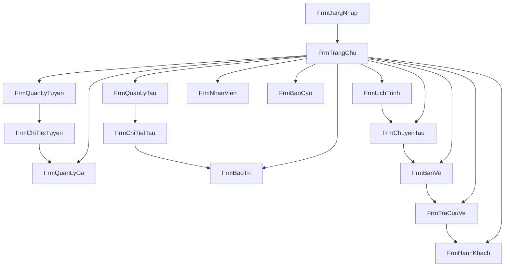

# Quản lý tàu điện ngầm — WinForms + SQL Server

Project viết trên Mac, chạy trên Windows: mở solution bằng Visual Studio, chạy script bằng SSMS. Giao diện và thông báo tiếng Việt. Tên bảng, cột, form không dấu.

Repo: https://github.com/thanhhale288/dotnet-quan-ly-tau

## Mục tiêu

Dựng project Windows Forms C# (.NET Framework 4.8) quản lý tàu điện ngầm, gồm:

- 15 form liên kết với nhau (mỗi form có `.cs` + `.Designer.cs`)
- File `KetNoi_DuLieu.cs` để đọc connection string và gọi stored procedure
- Script SQL Server tạo database, dữ liệu mẫu, view và stored procedure

## Stack

- C# Windows Forms, .NET Framework 4.8
- ADO.NET (`System.Data.SqlClient`)
- SQL Server (thường dùng Express: `.\SQLEXPRESS`)
- Connection string trong `QuanLyTau/App.config` (không hard-code trong form)

Mặc định App.config:

```xml
Data Source=.\SQLEXPRESS;Initial Catalog=QuanLyTau;Integrated Security=True;TrustServerCertificate=True;Connect Timeout=15
```

Trong file `.cs` nếu viết chuỗi: dùng `@"Data Source=.\SQLEXPRESS;..."` hoặc `"Data Source=.\\SQLEXPRESS;..."`.

## Luồng 15 form



Mỗi form danh sách có nút Thêm, Sửa, Xóa/Ngừng, Tải lại và nút mở form chi tiết. Form con nhận mã bản ghi qua constructor và có nút Đóng. Đóng form con không tắt cả ứng dụng; chỉ `FrmDangNhap` và `FrmTrangChu` điều khiển thoát / đăng xuất.

### Phân quyền sau đăng nhập

- **QuanLy**: mọi form
- **BanVe**: trang chủ, chuyến, bán vé, tra cứu vé, hành khách
- **KyThuat**: trang chủ, tàu, chi tiết tàu, bảo trì
- **LaiTau**: xem và cập nhật chuyến

Nút không thuộc quyền thì ẩn trên `FrmTrangChu`.

| # | Form | Việc của form | Mở tiếp |
|---|---|---|---|
| 1 | `FrmDangNhap` | Đăng nhập | Trang chủ |
| 2 | `FrmTrangChu` | Menu và số liệu nhanh: tàu sẵn sàng, chuyến hôm nay, vé hôm nay | Mọi module được phép |
| 3 | `FrmQuanLyTuyen` | Danh sách tuyến | Chi tiết tuyến |
| 4 | `FrmChiTietTuyen` | Sắp thứ tự ga, phút dừng trên tuyến | Mở quản lý ga |
| 5 | `FrmQuanLyGa` | Thêm, sửa, ngừng ga | Trang chủ hoặc từ tuyến |
| 6 | `FrmQuanLyTau` | Danh sách tàu, lọc theo trạng thái và tuyến | Chi tiết tàu |
| 7 | `FrmChiTietTau` | Sửa tàu và các toa | Bảo trì của tàu đó |
| 8 | `FrmBaoTri` | Phiếu bảo trì; mở từ tàu thì lọc sẵn mã tàu | Quay lại tàu hoặc trang chủ |
| 9 | `FrmLichTrinh` | Khung giờ lặp theo tuyến và tàu | Sinh chuyến trong khoảng ngày |
| 10 | `FrmChuyenTau` | Chuyến theo ngày, gán lái tàu, trạng thái | Bán vé cho chuyến đang chọn |
| 11 | `FrmBanVe` | Chọn ga đi, ga đến trên cùng tuyến, giá theo số ga | Tra cứu vé vừa bán |
| 12 | `FrmTraCuuVe` | Tìm theo mã vé, CCCD, ngày; hủy vé | Hồ sơ hành khách |
| 13 | `FrmHanhKhach` | Danh sách khách và vé của từng người | Mở tra cứu vé của khách đó |
| 14 | `FrmNhanVien` | Nhân viên và tài khoản, chỉ Quản lý | Quay lại trang chủ |
| 15 | `FrmBaoCao` | Doanh thu theo ngày, lượt vé theo tuyến, bảo trì | Quay lại trang chủ |

### Quy tắc nghiệp vụ (kiểm tra ở SQL)

- Ga đi phải đứng trước ga đến trên cùng tuyến
- Không bán vé khi chuyến hủy, đã chạy xong, hoặc hết chỗ
- Tàu `BaoTri` hoặc `Hong` không gán vào lịch mới
- Không xóa cứng bản ghi đang được tham chiếu; chuyển `TrangThai` sang ngừng dùng
- Bán vé là một transaction: tạo hoặc lấy hành khách theo CCCD, rồi thêm vé
- Giá vé = số ga đi qua × 10.000 đ; vé ưu tiên = một nửa

## Database — `Database/QuanLyTau.sql`

Một script chạy trên SSMS: tạo database `QuanLyTau`, bảng, khóa ngoại, view, stored procedure, dữ liệu mẫu.

**Quan trọng:** chạy script trên đúng instance mà `App.config` đang trỏ tới (ví dụ SSMS Server name = `.\SQLEXPRESS` nếu App.config dùng `Data Source=.\SQLEXPRESS`).

### Bảng

- `NhanVien` — họ tên, chức vụ (`QuanLy`, `BanVe`, `KyThuat`, `LaiTau`), tên đăng nhập, mật khẩu SHA-256, trạng thái
- `Ga` — tên ga, địa chỉ, khu vực
- `Tuyen` — tên tuyến, ga đầu, ga cuối
- `Tuyen_Ga` — tuyến, ga, thứ tự, phút dừng
- `Tau` — mã tàu, loại (`Metro` / `TauHoa`), sức chứa, tuyến đang gán, trạng thái
- `ToaTau` — số toa, loại toa, sức chứa
- `LichTrinh` — tuyến, tàu, giờ đi, giờ đến, các thứ trong tuần
- `ChuyenTau` — lịch, ngày chạy, nhân viên lái, trạng thái
- `HanhKhach` — họ tên, CCCD duy nhất, điện thoại
- `Ve` — chuyến, khách, ga đi, ga đến, loại vé, giá, nhân viên bán, trạng thái
- `BaoTri` — tàu, ngày, nội dung, chi phí, nhân viên kỹ thuật, trạng thái

### View / stored procedure tiêu biểu

- View: `vw_ChuyenTauChiTiet`, `vw_VeChiTiet`, `vw_DoanhThuTheoNgay`
- Procedure: `sp_DangNhap`, CRUD ga/tuyến/tàu/toa/lịch/chuyến/nhân viên/bảo trì, `sp_BanVe`, `sp_HuyVe`, `sp_SinhChuyen`, `sp_BaoCaoDoanhThu`, `sp_ThongKeTrangChu`

### Tài khoản demo

Mật khẩu gốc (app hash SHA-256 rồi so sánh): `123456`

| Tên đăng nhập | Quyền |
|---|---|
| admin | Quản lý |
| banve | Bán vé |
| kythuat | Kỹ thuật |
| laixe / laixe2 | Lái tàu |

## Cấu trúc solution (đã triển khai)

```
QuanLyTau.sln
plan.md
README.md
Database/QuanLyTau.sql
QuanLyTau/
  QuanLyTau.csproj
  App.config
  Program.cs
  KetNoi_DuLieu.cs     # kết nối + gọi SP + phiên làm việc + hộp thoại
  Properties/AssemblyInfo.cs
  Forms/               # mỗi form: .cs + .Designer.cs (không bắt buộc .resx)
    FrmDangNhap
    FrmTrangChu
    FrmQuanLyTuyen
    FrmChiTietTuyen
    FrmQuanLyGa
    FrmQuanLyTau
    FrmChiTietTau
    FrmBaoTri
    FrmLichTrinh
    FrmChuyenTau
    FrmBanVe
    FrmTraCuuVe
    FrmHanhKhach
    FrmNhanVien
    FrmBaoCao
```

`KetNoi_DuLieu` đọc connection string từ `App.config`, gọi stored procedure, trả `DataTable`. Form không viết SQL rải rác. `Program.cs` khởi động `FrmDangNhap`.

## Cách chạy trên Windows

1. Clone repo, mở SSMS kết nối đúng instance (ví dụ `.\SQLEXPRESS`).
2. Execute `Database/QuanLyTau.sql`.
3. Kiểm tra / sửa `QuanLyTau/App.config` cho khớp Server name trong SSMS.
4. Visual Studio: mở `QuanLyTau.sln` → Rebuild → F5.
5. Đăng nhập `admin` / `123456`.

Chi tiết clone và xử lý lỗi kết nối: xem `README.md`.

## Checklist triển khai

- [x] Viết `Database/QuanLyTau.sql` (bảng, khóa, view, SP, dữ liệu mẫu)
- [x] Tạo solution .NET Framework 4.8 WinForms + `App.config` + `KetNoi_DuLieu.cs`
- [x] Viết 15 form (`.cs` + `.Designer.cs`), điều hướng và phân quyền
- [x] Nối CRUD, bán vé, sinh chuyến, bảo trì, báo cáo với stored procedure
- [x] README tiếng Việt: SSMS, connection string, Visual Studio
